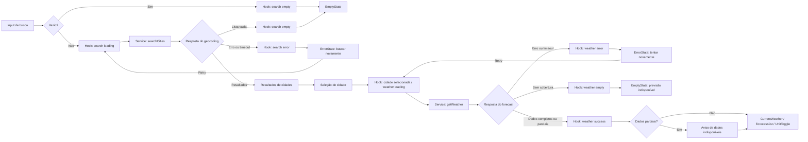

# Plano Técnico — Weather App

## Architecture

Aplicação React de página única, organizada em quatro camadas simples, com dependências em uma única direção: `components` → `hooks` → `services`; funções puras de `lib` e contratos de `types` podem ser usados pelas camadas superiores.

1. **Apresentação (`components/`):** componentes recebem dados/estados por props e comunicam ações por callbacks. Renderizam busca, clima atual, previsão e estados de loading/vazio/erro, preservando o tema Tailwind dark glassmorphism existente; não fazem `fetch`, não conhecem URLs e não mantêm regras de conversão.
2. **Orquestração (`hooks/`):** `useWeather` mantém resultados da busca, cidade selecionada e estados de carregamento/erro; coordena os services e descarta respostas antigas quando a seleção muda. A unidade de apresentação permanece em estado React em memória, sem persistência.
3. **Acesso a dados (`services/`):** `weatherService` é o único módulo que conhece URLs, parâmetros e payloads externos da Open-Meteo. Converte respostas para os tipos do domínio e normaliza falhas de rede, HTTP, timeout e payload inválido; não conhece componentes nem estado visual.
4. **Funções puras (`lib/`):** conversão e arredondamento de temperatura, formatação, cálculo/validação de datas e mapeamento WMO para rótulos pt-BR. Não acessa rede, DOM, React ou estado global.

`types/` contém contratos compartilhados, sem comportamento. Assim, cada camada pode ser testada isoladamente: componentes com props e interações simuladas; hooks com services mockados; services com `fetch` mockado; `lib` com entradas/saídas determinísticas. E2E valida fluxos integrados usando respostas de rede simuladas.

```text
SearchBar ──> useWeather ──> weatherService ──> Open-Meteo Geocoding
                  │
                  └────────> weatherService ──> Open-Meteo Forecast
                  │
                  └────────> CurrentWeather / ForecastList / states
                                  │
                                  └──> lib (WMO, unidades, formatação)
```

Componentes não fazem `fetch` diretamente. O estado da unidade fica em memória e a conversão ocorre apenas na apresentação; alternar °C/°F não dispara outra requisição. As chamadas usam exclusivamente endpoints públicos, sem API key e sem recursos `customer-`, conforme a spec.

## Tech Stack

- **TypeScript strict, React e Vite:** stack já definida pelo repositório, com tipos explícitos e desenvolvimento/build enxutos.
- **Tailwind CSS:** segue a configuração existente e preserva o tema dark glassmorphism do projeto em uma interface responsiva mobile-first.
- **Vitest e Testing Library:** testes unitários/de componentes, com verificações por roles e labels acessíveis.
- **Playwright:** testes dos fluxos completos em navegador e viewport móvel.
- **Biome:** lint e formatação existentes.
- **pnpm:** gerenciador já fixado no projeto.
- **Open-Meteo:** geocoding e previsão sem API key para os endpoints públicos selecionados.

Não adicionar biblioteca de estado, cliente HTTP ou camada de cache: `fetch`, React state e os utilitários já presentes atendem ao escopo.

## Project Structure

Estrutura pretendida, alinhada ao README e aos módulos do workshop:

```text
src/
  App.tsx                    # composição da página e unidade em memória
  components/
    SearchBar.tsx            # envio de busca e seleção de cidade
    CurrentWeather.tsx       # condição, temperatura e referência temporal
    ForecastList.tsx         # cinco resumos diários
    ForecastCard.tsx         # apresentação de um dia
    UnitToggle.tsx           # escolha °C/°F
    states/
      LoadingState.tsx       # solicitação em andamento
      EmptyState.tsx         # busca sem resultados
      ErrorState.tsx         # falha e ação de nova tentativa
  hooks/
    useWeather.ts            # estado e coordenação dos fluxos
  services/
    weatherService.ts        # geocoding e forecast Open-Meteo
  lib/
    temperature.ts           # conversão e arredondamento
    weatherCodes.ts          # WMO -> rótulo pt-BR
    format.ts                # datas e números pt-BR
  types/
    weather.ts               # contratos de domínio e estados
  styles/
    index.css                # Tailwind e estilos globais

tests/
  unit/                      # domínio, service e componentes
  e2e/                       # fluxos com Playwright e rede simulada
```

Um componente por arquivo. Componentes não importam `services`; somente hooks chamam serviços. `services` não importam componentes/hooks; `lib` permanece puro. Esses limites permitem substituir a rede por mocks, testar regras sem DOM e validar componentes sem depender da API. Não criar módulos de autenticação, persistência ou offline.

## Data Model

Contratos de domínio. Campos meteorológicos opcionais representam dados ausentes em respostas parciais; a UI deve marcá-los como indisponíveis, nunca inventar valores.

```ts
/** Unidade de temperatura escolhida para apresentação. */
export type Unit = 'celsius' | 'fahrenheit';

export interface City {
  id: number; // ID da localidade retornado pelo geocoding.
  name: string; // Nome da cidade retornado pelo geocoding.
  admin1?: string; // Região administrativa, quando disponível.
  country?: string; // País, quando disponível.
  latitude: number; // Latitude usada para consultar o forecast.
  longitude: number; // Longitude usada para consultar o forecast.
}

export interface CurrentWeather {
  temperatureC?: number; // `current.temperature_2m`, normalizada para Celsius.
  weatherCode?: number; // `current.weather_code`, código meteorológico WMO.
  referenceTime?: string; // `current.time`, horário de referência da fonte.
}

export interface ForecastDay {
  date: string; // Data YYYY-MM-DD no fuso da cidade; sempre uma das cinco datas esperadas.
  weatherCode?: number; // `daily.weather_code`, código meteorológico WMO.
  minC?: number; // `daily.temperature_2m_min`, normalizada para Celsius.
  maxC?: number; // `daily.temperature_2m_max`, normalizada para Celsius.
}

export interface WeatherData {
  city: City; // Localidade selecionada pelo usuário.
  timezone: string; // `timezone` retornado pelo forecast para a localidade.
  current?: CurrentWeather; // Condições atuais; ausente se não houver dados.
  forecast: ForecastDay[]; // Exatamente cinco datas consecutivas; dados ausentes ficam indisponíveis.
}

type RequestErrorKind = 'network' | 'api' | 'timeout' | 'invalid-response';

type RequestState<T> =
  | { status: 'idle' }
  | { status: 'loading' }
  | { status: 'success'; data: T }
  | { status: 'empty'; message: string }
  | { status: 'error'; kind: RequestErrorKind; message: string };
```

`weatherCode` usa os códigos WMO da fonte. Um código sem mapeamento é apresentado como “Condição não disponível”. `referenceTime` é o horário de referência/observação da fonte, nunca o horário de recebimento da resposta. Temperaturas internas permanecem em Celsius.

Invariantes: busca retorna no máximo cinco cidades; uma cidade selecionada identifica todo `WeatherData`; o forecast contém exatamente hoje e os quatro dias seguintes no timezone da cidade; unidade não é persistida; códigos/dados opcionais nunca são convertidos em valores fictícios.

## Data Flow

1. A pessoa envia o nome da cidade; input vazio é validado localmente e não gera requisição.
2. `useWeather` muda a busca para `loading` e chama `searchCities`.
3. `weatherService` consulta geocoding, normaliza no máximo cinco resultados e devolve `City[]`. Lista vazia vira estado vazio, não erro.
4. A pessoa seleciona um resultado; o hook marca essa cidade como atual e descarta resultados de solicitações anteriores que cheguem fora de ordem.
5. O hook chama `getWeather(city)`, que consulta o forecast e normaliza clima atual, timezone e cinco posições diárias.
6. A UI apresenta dados disponíveis, estados parciais/ausentes e horário de referência. Idade acima de duas horas gera aviso; sem timestamp, “Atualidade não informada”.
7. Componentes formatam condição/data em pt-BR. Conversão C/F ocorre na camada de apresentação; a seleção não refaz a consulta.
8. Em erro, a mensagem e a ação “Tentar novamente” preservam a consulta/cidade para repetir apenas a operação que falhou.



## External APIs

### Geocoding

**URL pública:** `https://geocoding-api.open-meteo.com/v1/search`

| Parâmetro | Valor/contrato |
|---|---|
| `name` | Nome da localidade enviado pelo usuário, codificado como query string. |
| `count` | `5`, limite máximo de resultados do MVP. |
| `language` | `pt`, para nomes localizados quando disponíveis. |
| `format` | `json`. |

`current`, `daily` e `timezone` não se aplicam a este endpoint.

Exemplo resumido de resposta bem-sucedida:

```json
{
  "results": [
    {
      "id": 2950159,
      "name": "Berlin",
      "latitude": 52.52437,
      "longitude": 13.41053,
      "country": "Germany",
      "admin1": "Berlin"
    }
  ]
}
```

Mapeamento para `City`: `id`, `name`, `admin1`, `country`, `latitude` e `longitude` são copiados para os campos homônimos. `admin1` e `country` podem estar ausentes; a UI usa os valores disponíveis para desambiguar e coordenadas como último fallback. Se a resposta não incluir `results` ou trouxer lista vazia, produzir o estado sem resultados, não um erro de serviço.

### Forecast

**URL pública:** `https://api.open-meteo.com/v1/forecast`

| Parâmetro | Valor/contrato |
|---|---|
| `latitude`, `longitude` | Coordenadas da `City` selecionada. |
| `current` | `temperature_2m,weather_code`; `time` é retornado como referência temporal do bloco `current`. |
| `daily` | `weather_code,temperature_2m_min,temperature_2m_max`. |
| `forecast_days` | `5`: hoje e os quatro dias seguintes. |
| `timezone` | `auto`, para usar o fuso local inferido a partir das coordenadas. |
| `temperature_unit` | `celsius`, base canônica do domínio. |

Exemplo resumido de resposta bem-sucedida:

```json
{
  "latitude": 52.52,
  "longitude": 13.42,
  "timezone": "Europe/Berlin",
  "current": {
    "time": "2026-10-29T12:00",
    "temperature_2m": 14.2,
    "weather_code": 3
  },
  "daily": {
    "time": ["2026-10-29", "2026-10-30", "2026-10-31", "2026-11-01", "2026-11-02"],
    "weather_code": [3, 2, 61, 3, 1],
    "temperature_2m_min": [9.1, 8.4, 7.2, 6.8, 8.0],
    "temperature_2m_max": [14.2, 15.0, 12.1, 13.4, 16.0]
  }
}
```

Mapeamento para os tipos do domínio:

- `WeatherData.city`: a `City` selecionada que originou a requisição.
- `WeatherData.timezone`: resposta `timezone`.
- `WeatherData.current.temperatureC`: `current.temperature_2m`; `weatherCode`: `current.weather_code`; `referenceTime`: `current.time`.
- Cada `ForecastDay.date`: data esperada no timezone retornado; localizar o índice correspondente em `daily.time` e mapear `weather_code`, `temperature_2m_min` e `temperature_2m_max` por essa data, não por posição deslocável do array.
- `weatherCode` é um código WMO, traduzido localmente para pt-BR. Não solicitar campo de texto de condição à API.

Construir primeiro as cinco datas esperadas (hoje e os quatro dias seguintes) usando o timezone retornado pela API; indexar `daily.time` por data e fazer merge nessa sequência. Se uma data ou campo não vier, manter a posição e marcar seus valores como indisponíveis, sem deslocar dados de dias seguintes nem inventar valores. `timezone=auto` e `daily.time` definem as datas locais; não reinterpretar as datas no fuso do navegador.

**Contrato operacional:** usar somente os endpoints públicos acima; não enviar `apikey` nem chamar URL com prefixo `customer-`. Aplicar timeout de 10 segundos. Antes do release, registrar evidência oficial vigente de autorização, cobertura, cotas e atribuição exigida (NFR-10). Se o uso não estiver autorizado, bloquear release e reabrir a escolha do provedor.

## State Management

Manter estado local em `useWeather` e `App`; não introduzir store global. Busca e clima têm estados independentes do tipo `RequestState<T>`:

- **`idle`:** ainda não houve solicitação, ou o usuário está no estado inicial.
- **`loading`:** solicitação em andamento; encerrar após sucesso, erro ou timeout de 10 segundos.
- **`success`:** há ao menos uma seção meteorológica utilizável (clima atual ou previsão). Resposta parcial ainda é sucesso; campos/dias ausentes permanecem opcionais em `WeatherData` e são exibidos como indisponíveis.
- **`empty`:** geocoding válido sem resultados ou resposta de forecast válida sem nenhum dado meteorológico utilizável. Exibe mensagem apropriada e não é tratado como falha de transporte.
- **`error`:** falha de rede/API/timeout ou payload estruturalmente impossível de interpretar, identificada por `RequestErrorKind` e apresentada com mensagem estável e ação de retry.

`useWeather` possui `searchState`, `weatherState` e `selectedCity`. `App` mantém somente `unit: Unit`, iniciada em Celsius a cada sessão. Não persistir cidade nem unidade.

Temperaturas ficam armazenadas exclusivamente em Celsius. Durante cada render, uma função pura recebe Celsius e unidade selecionada, aplica `F = C * 9 / 5 + 32` quando necessário, arredonda ao inteiro mais próximo com empates afastados de zero e formata o rótulo. Não armazenar uma segunda cópia convertida e não fazer nova requisição ao alternar °C/°F.

Ao selecionar outra cidade, não apresentar dados anteriores como se fossem da nova cidade. Cancelar com `AbortController` ou usar um identificador sequencial para ignorar respostas fora de ordem; escolher uma estratégia, sem combinar ambas. Não manter cache.

## Error Handling

- **Rede:** exceção de `fetch` vira `kind: 'network'`; busca mostra “Não foi possível buscar cidades. Tente novamente.” e forecast mostra “Não foi possível carregar o clima. Tente novamente.”. Manter a consulta para retry.
- **API:** resposta HTTP não-OK ou payload que indique erro vira `kind: 'api'`; não expor corpo bruto da resposta nem classificar falha como geocoding vazio. Usar a mensagem estável correspondente à operação.
- **Timeout:** após 10 segundos, abortar a solicitação e definir `kind: 'timeout'`; finalizar loading, mostrar mensagem da operação e ignorar respostas tardias.
- **Resposta inválida:** JSON ilegível, raiz incompatível com o objeto esperado ou tipos estruturais impossíveis de mapear viram `kind: 'invalid-response'`; não exibir dados incorretos e informar indisponibilidade. Campos numéricos opcionais ausentes ou dias sem valores não tornam, por si só, a resposta inválida.
- **Geocoding vazio:** resposta válida com lista vazia define `empty` e mostra “Nenhuma cidade encontrada”; não chamar forecast.
- **Input vazio:** validar localmente, não chamar a API e mostrar “Informe o nome de uma cidade para iniciar a busca”.
- **Cidade sem cobertura:** geocoding válido seguido de resposta de forecast válida sem nenhum dado atual ou diário utilizável define `empty` e mostra “Previsão não disponível para esta cidade”.
- **Resposta parcial:** quando ao menos uma seção tem dados válidos, manter `success`; gerar as cinco datas esperadas no timezone da cidade, associar dados pela data, marcar campos/dias ausentes e mostrar “Alguns dados não estão disponíveis” na seção afetada, sem inventar valores nem deslocar dados entre dias.
- **Referência temporal:** sem horário retornado, mostrar “Atualidade não informada”; acima de duas horas, manter os dados e mostrar “Dados desatualizados”. Nunca substituir o horário da fonte pelo horário de recebimento.
- **Código WMO desconhecido:** mostrar “Condição não disponível”.
- Em todos os resultados, encerrar loading; mensagens de erro, vazio e carregamento devem ser visíveis e anunciadas às tecnologias assistivas. O service classifica falhas; componentes só consomem `RequestState` e não interpretam HTTP/payloads externos.

## Testing Strategy

- **Funções puras (Vitest):** cobrir conversão C/F, arredondamento (incluindo valores negativos e empates), mapeamento de códigos WMO conhecidos/desconhecidos e formatação de datas/números em pt-BR e timezone da cidade.
- **Services (Vitest + `fetch` mockado):** verificar URLs e parâmetros de geocoding/forecast, até cinco resultados, `language=pt`, cinco dias, `timezone=auto`, Celsius, ausência de `apikey` e `customer-`, mapeamento dos payloads, caracteres especiais, resposta vazia/parcial, lacuna em data intermediária, erro HTTP/rede e timeout de 10 segundos. Não chamar serviços reais.
- **Hooks e componentes (Vitest + Testing Library):** testar os estados `idle`, `loading`, `success`, `empty` e `error`; busca e seleção; dados atuais e cinco resumos; campos/dias parciais; estado desatualizado; retry; troca rápida de cidade/respostas fora de ordem; alternância de unidade sem nova chamada. Verificar por roles/labels e se loading/erro são anunciados por tecnologia assistiva.
- **Playwright (E2E):** interceptar todas as rotas Open-Meteo com respostas determinísticas. Cobrir o fluxo busca → seleção → clima atual/previsão → alternância; busca vazia/sem resultados; geocoding e forecast indisponíveis; resposta parcial com uma data intermediária ausente; timeout e retry. Rodar nos viewports 320 × 568 e 1280 × 720 e nas combinações de navegador/plataforma de NFR-05. Nunca depender da API real.
- **NFRs:** automatizar verificações de responsividade e acessibilidade; medir o NFR-03 com resposta simulada instantânea em 20 execuções por fluxo; validar manualmente o uso com leitor de tela conforme NFR-02/NFR-09.
- **Gate de release:** anexar evidência do NFR-10; autorização, cobertura, cotas e atribuição do provedor são verificações documentais, distintas dos testes automatizados.

Rodar os comandos existentes conforme cada mudança: `pnpm lint`, `pnpm build`, `pnpm test`; usar `pnpm test:e2e` para E2E.

## Risks & Trade-offs

| Decisão | Alternativa considerada | Trade-off |
|---|---|---|
| Estado local em `useWeather`/React | Store global (Redux/Zustand/Context) | Menos dependências e fluxo explícito para um app de tela única; store global facilitaria estado compartilhado se o produto crescer, mas não é necessário no MVP. |
| `fetch` nativo isolado em `weatherService` | Axios ou cliente de dados/cache (ex.: TanStack Query) | Menos dependências e controle direto de timeout/mapeamento; bibliotecas oferecem retry/cache prontos, mas cache/persistência não fazem parte do escopo atual. |
| Endpoints públicos Open-Meteo sem chave e sem `customer-` | Endpoint reservado com API key ou proxy próprio | Mantém a decisão da spec e não expõe segredos; limita a aplicação às condições dos endpoints públicos. Termos, cobertura, cotas e atribuição são gate de release (NFR-10). |
| Sem cache, persistência ou offline | `localStorage`, cache HTTP controlado ou service worker | Evita dados persistidos/desatualizados e reduz complexidade; falhas de rede exigem nova tentativa e a cidade/unidade não sobrevive ao reload. |
| Previsão diária de cinco dias | Previsão horária ou horizonte maior | Payload e interface simples alinhados ao MVP; menor detalhe para planejamento intradiário, explicitamente fora do escopo. |
| Celsius como unidade canônica; conversão na renderização | Solicitar novamente à API ao alternar unidade | Garante consistência entre clima atual/previsão e evita chamadas extras; a formatação/arredondamento fica sob responsabilidade da aplicação. |
| Datas no timezone retornado para a cidade | Usar timezone do navegador | Mantém as datas corretas para a localidade consultada; exige usar `timezone=auto` e não reinterpretar `daily.time` no fuso do dispositivo. |
| Preservar seções/dias válidos em resposta parcial | Rejeitar o snapshot completo se qualquer campo faltar | Mantém informação útil e segue AC-05.2; exige representar ausências explicitamente e testar campos/dias faltantes. |
| Personas como hipóteses até teste de usabilidade | Tratar as personas como pesquisa validada | Permite fechar o escopo do MVP sem alegar validação inexistente; NFR-09 segue como critério de lançamento. |